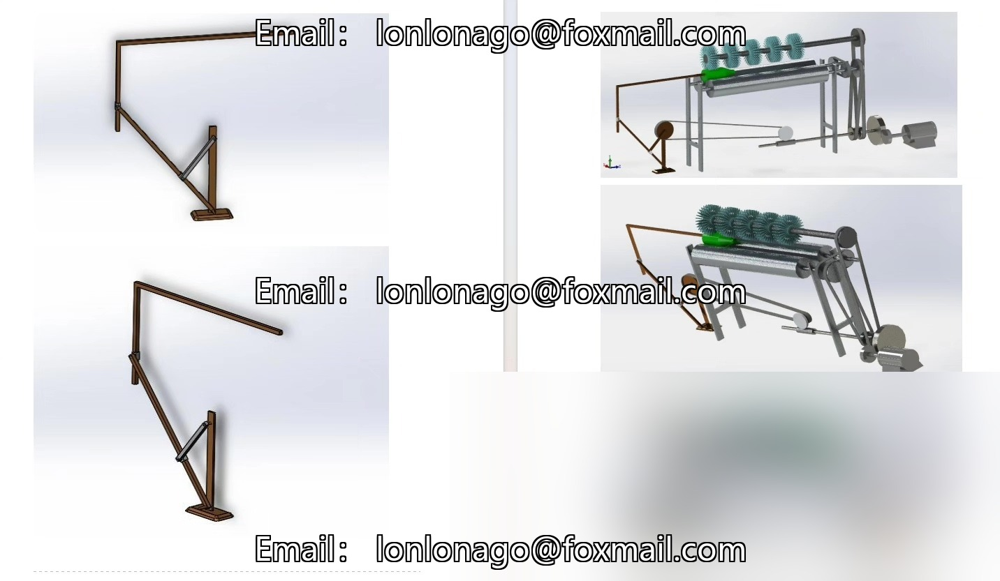

# Washing machine number/form factor 3D washing machine number/form factor

## Body

Washing machine parametric model 3D model 3D model of washing machine
Can be opened and edited with CATIA UG SolidWorks and other software
There are other various types of 3D drawings besides A035, and services such as modeling and parametric model modification, with specific details to be discussed further

The image is empty; the description indicates the washing machine digital model offers 3D processing, can be opened and edited with tools such as Catia UG and SolidWorks, and other modeling and digital model modification services are available.

<!-- AI_ENRICHED -->

## Images

## Payment

Here is a pay link on Stripe ( https://buy.stripe.com/3cs8yP7sY87d0vu9AB ). Please contact me lonlonago@foxmail.com after funding $89, and I will send you a complete data files , thank you!

